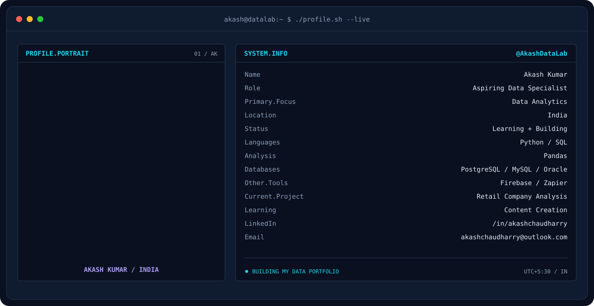
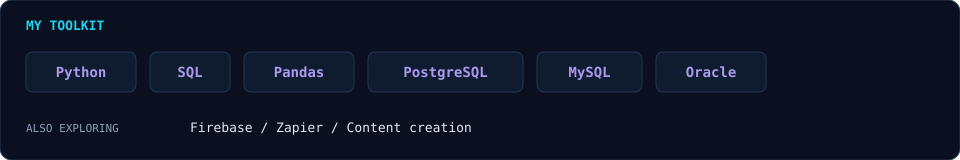
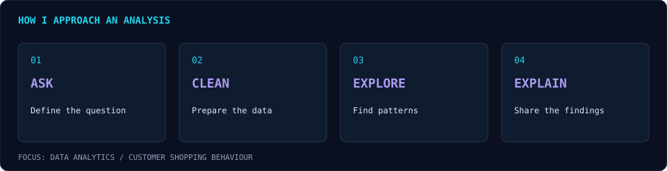
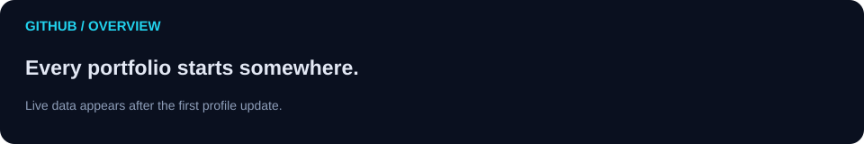
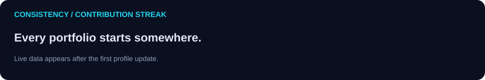
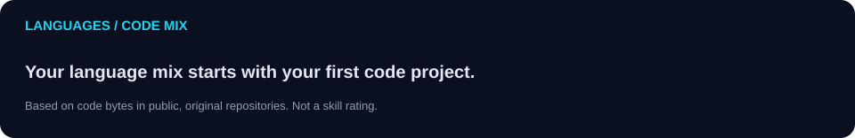
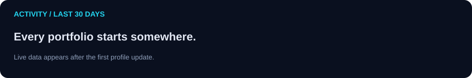
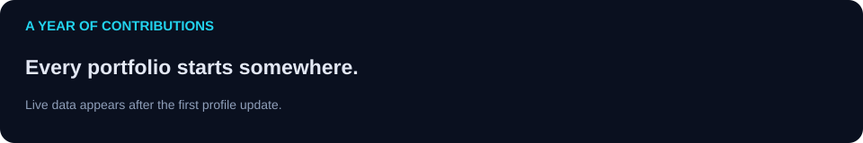
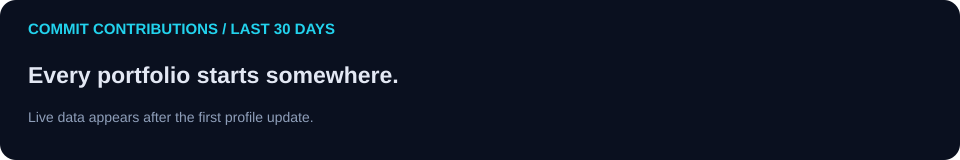

<picture>
  <source media="(prefers-color-scheme: light)" srcset="assets/banner-light.svg" />
  
</picture>

<picture>
  <source media="(prefers-color-scheme: light)" srcset="assets/typing-light.svg" />
  
</picture>

<b>Data analytics · Python · SQL · Learning in public</b>

<a href="https://www.linkedin.com/in/akashchaudharry/"><picture>
  <source media="(prefers-color-scheme: light)" srcset="assets/linkedin-light.svg" />
  
</picture></a>
<a href="mailto:akashchaudharry@outlook.com"><picture>
  <source media="(prefers-color-scheme: light)" srcset="assets/email-light.svg" />
  
</picture></a>
<a href="https://github.com/AkashQuants?tab=repositories"><picture>
  <source media="(prefers-color-scheme: light)" srcset="assets/github-light.svg" />
  
</picture></a>

---

## This is me :)

Hi, I'm **Akash Kumar**, an aspiring data specialist from India 🇮🇳. My main focus is **data analytics** — understanding the data, asking useful questions, and explaining what I find.

- 🔎 **Currently building:** Leading Retail Company Analysis, focused on customer shopping behaviour.
- 🐍 **My data toolkit:** Python, Pandas, and SQL, with PostgreSQL, MySQL, and Oracle.
- 🌱 **Currently learning:** Content creation, so I can share my projects and learning more clearly.
- 🛠️ **This profile:** A growing collection of projects, practice, and notes as I develop my skills.
- 📫 **Let's connect:** [akashchaudharry@outlook.com](mailto:akashchaudharry@outlook.com)

## My toolkit

<picture>
  <source media="(prefers-color-scheme: light)" srcset="assets/toolkit-light.svg" />
  
</picture>

## From questions to findings

<picture>
  <source media="(prefers-color-scheme: light)" srcset="assets/focus-light.svg" />
  
</picture>

## Featured projects

**Leading Retail Company Analysis** · *In progress*  
Exploring customer shopping behaviour through a retail analysis project. I'll share the repository and findings when they're ready.

<!-- PROJECTS:START -->
*My published projects will appear here as this portfolio grows.*
<!-- PROJECTS:END -->

[Explore all my repositories →](https://github.com/AkashQuants?tab=repositories)

---

## Numbers, with context.

<picture>
  <source media="(prefers-color-scheme: light)" srcset="assets/overview-light.svg" />
  
</picture>

<picture>
  <source media="(prefers-color-scheme: light)" srcset="assets/streak-light.svg" />
  
</picture>

<picture>
  <source media="(prefers-color-scheme: light)" srcset="assets/languages-light.svg" />
  
</picture>

## One contribution at a time

<picture>
  <source media="(prefers-color-scheme: light)" srcset="assets/activity-light.svg" />
  
</picture>

<picture>
  <source media="(prefers-color-scheme: light)" srcset="assets/calendar-light.svg" />
  
</picture>

<b>See the commit graph &amp; how these numbers work</b>

 

<picture>
  <source media="(prefers-color-scheme: light)" srcset="assets/commits-light.svg" />
  
</picture>

Contribution totals follow GitHub's counting rules. Streaks use UTC days and the rolling-year calendar. Today's streak stays open until the day ends. Language percentages measure code bytes in public, original repositories; they are not skill ratings.

<!-- UPDATED:START -->
Activity cards are ready for their first automated update.
<!-- UPDATED:END -->

---

<code>Ask better questions. Make sense of data. — @AkashQuants</code>

